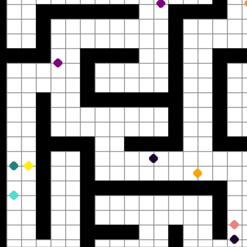
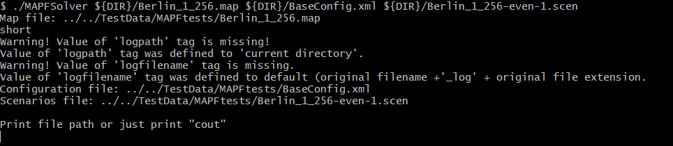
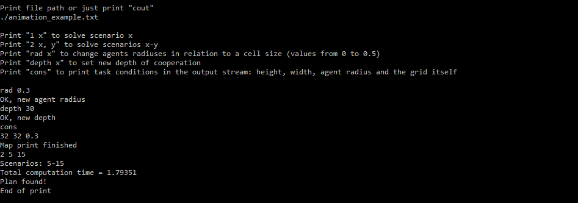

# Multi-Agent Pathfinding

Need to find collision-free paths for multiple agents? This library can help you!



This library contains implementations of single-agent and multi-agent pathfinding solvers for 2D grid map with different environment settings. In particular, we use A* and WHCA*, which are more suitable for practical application. This project has a lot of flexibility in mind, so the best way to start using it is to build a console application and experiment with different options.

### Quick Start

At first, let's build our console app.

```bash
cd MultiAgentPathFinding/Build/Release
cmake ../../ -DCMAKE_BUILD_TYPE="Release" -DMAPF=ON -DTESTS=OFF
make
make install
```

To build on **Windows** you choose another generator for CMake. To do this simply add `-G` flag: 

```bash
cd MultiAgentPathFinding/Build/Debug
cmake ../../ -DCMAKE_BUILD_TYPE="Debug" -G "MinGW Makefiles" -DMAPF=ON -DTESTS=OFF
mingw32-make
mingw32-make install
```

As you can see, you can also use Debug configuration. 

To run the app use command arguments: map name, configuration file, file with scenarios.

```bash
DIR=../../TestData/MAPFtests
./MAPFSolver ${DIR}/Berlin_1_256.map ${DIR}/BaseConfig.xml ${DIR}/Berlin_1_256-even-1.scen
```

You are going to see an output like this:



The next instructions will show how to plan paths and change options of the algorithm.

### Visualization

You can look at found paths using **visualise.py**. To do this, start an application with a file path entered, set any options you need. 

* Type "cons" to write conditions of the problem in the file (for example, the size of a map).
* Get a solution to one task using the format described in the printed instructions.
* Exit the program and run **visualise.py** to print the path of the file and enjoy an animation.

Check the example bellow:



### Input and output

This section describes the formats of files used in this project. 3 different files describe the structure of the map (traversable and nonreversible cells), configuration for algorithm with a list of possible moves, scenarios for agents (their start and goal locations). To find an example of these files you can go to *TestData/MAPFtests* and look at *maze-32-32-2.map*, *BaseConfig.xml* and *maze-32-32-2-even-1.scen*. These files with map and scenarios were borrowed from **movingai.com**, so that the IO format can be compatible with benchmarks presented there. If you need details on this format, visit [this link](https://movingai.com/benchmarks/formats.html).

The main field in a config file is *algorithm*, which describes options of a low-level path planning:

- *searchtype* can be "dijkstra" or "astar" to use Dijkstra or A* algorithm respectively;
- *metrictype* describes heuristic to use (if A* is chosen):
  - diagonal — diagonal metric
  - manhattan — Manhattan distance
  - euclidean — Euclidean distance
  - chebyshev — Chebyshev distance
- *hweight* is a multiplicator for heuristic
- *allowdiagonal* is true or false and allows the algorithm to consider paths through diagonals
- *cutcorners* is true or false and allows to use diagonals which intersect with one non-traversable cell on the way
- allowsqueeze is true or false and allows to use diagonal if it intersects two two non-traversable cells

### Single-Agent Pathfinding

As a part of this project we also implemented an A* algorithm, which can be used for single-agent pathfinding problems. To use it you can build the same project with the flag MAPF set OFF. A path is still constructed on a 2D plane with traversable and non-traversable cells. However, each task is given as a separate XML file. The format is shown in *Examples/example.xml*.

This is like a config file for a MAPF problem, but is has additional fields such as *map*, which describes the geometry of the plane and obstacles on it. You can choose size of the cell grid, locations of obstacles, start and finish locations. Positions start in the left upper corner with coordinates (0, 0).

The output of the program is the same file with the "_log" suffix. It will show information about the search in the *log* field.

- *mapfilename* shows the original path to the file with task description.
- *summary time* is number of seconds which the program ran.
- *length_scaled* is the length of the found path with the map's *cellsize* multiplicator.
- *length* is the same but without multiplicator.
- *nodescreated* is the number of cells which the algorithm considered and created nodes for.
- *numberofsteps* is the number of nodes which the algorithm worked with (expanded and examined) in the path planning loop.
-  *path* draws a path from start to finish if it was found.
- *lplevel* and *hplevel* describe the path and short and long versions respectively.

### Documentation

To learn more about this library and the details of the presented code base you can visit wiki.

### Mentors

A big thanks to the mentors on this project!

[**Konstantin Yakovlev**](http://kyakovlev.me/ru/home/)

[**Stepan Dergachev**](https://github.com/haiot4105)

